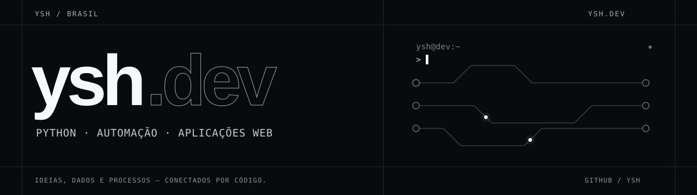

<a href="https://www.yshdev.me/">
  <picture>
    <source media="(prefers-reduced-motion: reduce)" srcset="assets/ysh-banner-poster.svg">
    
  </picture>
</a>

  <a href="https://www.yshdev.me/">portfólio</a> &nbsp; / &nbsp;
  <a href="#projetos-selecionados">projetos</a> &nbsp; / &nbsp;
  <a href="mailto:yshdev@outlook.com">contato</a>

## Olá, sou ysh

<picture>
  <source media="(prefers-color-scheme: dark)" srcset="assets/typing-dark.svg">
  
</picture>

Desenvolvo **automações em Python e aplicações web** para conectar dados, organizar rotinas e transformar ideias em ferramentas úteis. Trabalho com APIs, interfaces em TypeScript e experiências mobile com Flutter.

## Projetos selecionados

- **[HookLedger](https://github.com/fbccsz/hookledger-webhook-studio)** — console para testar e depurar webhooks, com regras, rastros de execução e reprocessamento de falhas. API local em Python/FastAPI com HMAC, idempotência e SQLite; interface React/TypeScript. [Experimentar](https://hookledger-webhook-studio.vercel.app/).
- **[FieldOps](https://github.com/fbccsz/fieldops-service-crm)** — CRM operacional para empresas de serviços: funil comercial, clientes, orçamentos e agendamento. Demo interativa com dados fictícios, JavaScript modular e testes com Node.js. [Experimentar](https://fieldops-service-crm.vercel.app/).
- **[WebScrap do Bem](https://github.com/fbccsz/webscrapdobem)** — painel de publicações com coleta via Apify, filtros e cache local. Python, Streamlit, Pandas e SQLite. [Experimentar](https://webscrapdobem.streamlit.app/).
- **[Frameflow](https://github.com/fbccsz/editor-video)** — vídeos a partir de imagens e locução, com ferramenta Python e processamento local no navegador. [Experimentar](https://fbccsz.github.io/editor-video/).
- **[Outlook Automation](https://github.com/fbccsz/outlook-automation-python)** — mensagens personalizadas a partir de planilhas, com execução local no Outlook e protótipo web de simulação.
- **[Saga do Empreendedorismo](https://github.com/fbccsz/saga-do-empreendedorismo)** — experimento de jogo com exploração, combate e gestão de recursos em JavaScript. [Jogar](https://fbccsz.github.io/saga-do-empreendedorismo/).

O [portfólio](https://www.yshdev.me/#projects) reúne o contexto, as tecnologias e o estágio de cada projeto, incluindo trabalhos com código privado.

## Ferramentas que uso

  &nbsp;
  &nbsp;
  &nbsp;
  &nbsp;
  

  &nbsp;
  &nbsp;
  &nbsp;
  &nbsp;
  &nbsp;
  

**Backend e automação** · Python, FastAPI, Pandas, OpenPyXL  
**Web** · TypeScript, JavaScript, React, Vite, HTML e CSS  
**Dados e integrações** · SQL, SQLite, SQLAlchemy, Supabase, APIs REST e n8n  
**Mobile e desenvolvimento** · Flutter, Dart, Git e Linux

---

Projetos de automação, ferramentas para negócios e aplicações web: **[yshdev@outlook.com](mailto:yshdev@outlook.com)**.

